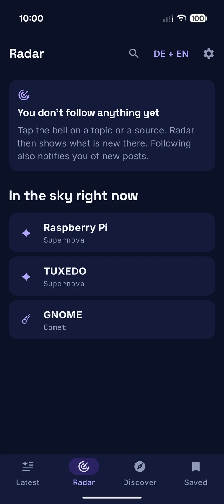
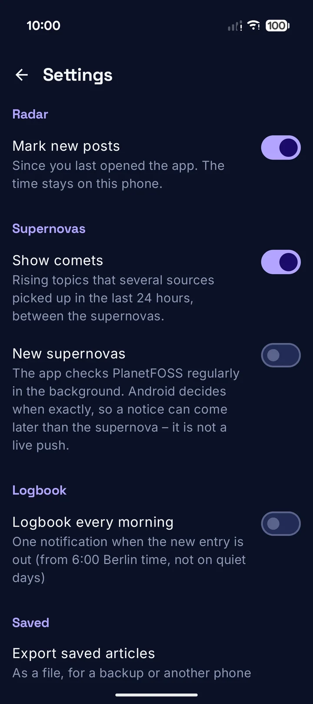

  

<h1 align="center">PlanetFOSS for Android</h1>

<strong>Linux and open source news from around 200 sources, on your phone.</strong>

  The app for <a href="https://planetfoss.net/en/">PlanetFOSS</a>, the news aggregator for Linux and free software.
  The big stories on top, a logbook every morning, a radar for what you follow.
  No account, no Google services, no tracking.

  <a href="https://github.com/freiversum/planetfoss-android/releases/latest"><strong>Download APK</strong></a>
  &nbsp;·&nbsp;
  <a href="#install">Google Play: closed test</a>
  &nbsp;·&nbsp; F-Droid: planned &nbsp;·&nbsp;
  <a href="https://linuxundich.de/en/projects/planetfoss-android/">Project page</a>
  &nbsp;·&nbsp;
  <a href="CHANGELOG.md">Changelog</a>

  
  
  
  

## What it does

<table>
<tr>
<td width="33%" valign="top">

### The big stories on top

When many sites cover the same topic at once, it becomes a **supernova**.
*Latest* shows every burning supernova first, then the comets, which are
topics on the rise, then the newest posts.

</td>
<td width="33%" valign="top">

### One story, one card

The same release news from five sites shows up once, bundled, with all the
reports listed. You see who writes what, and every card leads to the
original article.

</td>
<td width="33%" valign="top">

### Follow, don't scroll

Tap the bell on a topic or a source, and *Radar* shows what is new there
since your last visit. What you follow stays on your phone.

</td>
</tr>
</table>

<table>
<tr>
<td valign="middle">

### A logbook every morning

Every day from 6 a.m. the logbook sums up the last 24 hours: the biggest
story, the comets and the new releases. On quiet days there is no entry.

### A review every week

The last full week in numbers, with its supernovas, the most noticed releases
and the topics of the week. Both live under *Discover*, next to search,
rubrics, videos and the posts readers have starred.

### Notifications without a push server

If you like, the app tells you about new supernovas, the morning logbook and
what you follow. Android checks PlanetFOSS in the background for that, with no
Google service involved. Notifications are off until you turn them on.

</td>
<td width="270" align="center">

</td>
</tr>
</table>

<table>
<tr>
<td width="270" align="center">

</td>
<td valign="middle">

### Read now or later

Articles open in your phone's browser, or in the app's own browser with
optional protection from third-party trackers. The bookmark keeps posts under
*Saved*, also offline, and the collection can be exported and imported. If you
run Karakeep, linkding, Linkwarden or Readeck, every saved post can also go
straight to your own bookmark service.

### On your home screen

Two widgets show the newest logbook and the topics you follow.

### Private by design

No account, no analytics, no ads service. The app only talks to
planetfoss.net and to the sites you open. Counting opened articles for the
sources is off unless you switch it on. Everything that leaves the phone is
listed in the [privacy notes](PRIVACY.md).

</td>
</tr>
</table>

## At a glance

| | |
|---|---|
| **Runs on** | Android 14 or newer, no Google services needed |
| **Languages** | Interface in English and German, content in English, German or both |
| **News from** | around 200 blogs, magazines and projects, collected by [PlanetFOSS](https://planetfoss.net/en/) |
| **Costs** | nothing, no ads service, no account |
| **Licence** | GPL-3.0-or-later |

## Install

<table>
<tr>
<th width="50%">APK from GitHub</th>
<th width="50%">Google Play, closed test</th>
</tr>
<tr>
<td valign="top">

1. Download `planetfoss-<version>.apk` from the [latest release](https://github.com/freiversum/planetfoss-android/releases/latest).
2. Open it on your phone. Android asks once whether your browser may install apps.
3. Later versions install over the old one and keep your settings.

</td>
<td valign="top">

1. With the Google account on your phone, join the group [PlanetFOSS Tester](https://groups.google.com/g/planetfoss-tester).
2. On the [testing page](https://play.google.com/apps/testing/net.planetfoss.app), tap *Become a tester*.
3. Install the app from the link on that page and keep it for two weeks.

</td>
</tr>
</table>

> [!TIP]
> Testers wanted: new developer accounts on Google Play need twelve testers who
> stay for 14 days before an app may go public. Every tester helps.

> [!NOTE]
> Google Play signs its builds with its own key. The APK from GitHub and the
> Play version cannot update each other, so switching means uninstalling
> first. Export your saved posts before you do.

## Questions

<strong>Where does the news come from?</strong>

From [PlanetFOSS](https://planetfoss.net/en/). The app fetches its public
lists and sends you to the original article for reading.

<strong>Why do notifications sometimes arrive late?</strong>

Android decides when the app may check in the background, between 15 minutes
and three hours depending on battery and usage. This is no live ticker.

<strong>Does the app block ads?</strong>

No. The app's browser can block third-party trackers if you switch that on.
The sites' ads stay, and the app passes PlanetFOSS on as the referrer, so the
sites see where their readers come from.

<strong>Does it work without Google services?</strong>

Yes. The app uses none of them, and it is built to be published on F-Droid.

<strong>Can I use the PlanetFOSS name for my fork?</strong>

The code is free software, the PlanetFOSS name and logo are not covered by its
licence. Please rename a fork.

## On the blog

PlanetFOSS for Android has its own page on my blog
[Linux und Ich](https://linuxundich.de/en/projects/planetfoss-android/), with more
details on the app and news about upcoming versions. The
[project overview](https://linuxundich.de/en/projects/) lists everything else
I build for Linux and Android. Questions, ideas or feedback that don't fit
into an issue? [Get in touch](https://linuxundich.de/en/contact/), I read
every message.

## More

- [Project page on linuxundich.de](https://linuxundich.de/en/projects/planetfoss-android/): details, background and news
- [Technical notes](docs/TECHNICAL.md): building, testing and the design documents
- [Privacy notes](PRIVACY.md): everything that leaves the phone
- [Changelog](CHANGELOG.md) and [licences of all libraries and assets](LICENSES.md)
- Found a bug or missing something? [Open an issue](https://github.com/freiversum/planetfoss-android/issues)

PlanetFOSS for Android is AI-assisted: the code was written with AI assistance,
following my directions. I made the decisions, reviewed the results and tested
everything on my own devices.

## License

Copyright (C) 2026 Christoph Langner

This program is free software: you can redistribute it and/or modify it under the
terms of the GNU General Public License as published by the Free Software
Foundation, either version 3 of the License, or (at your option) any later version.
See [LICENSE](LICENSE).

The PlanetFOSS name and logo are not covered by this licence.
