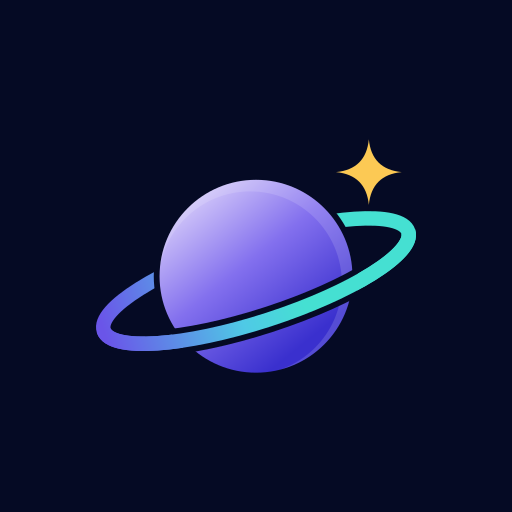
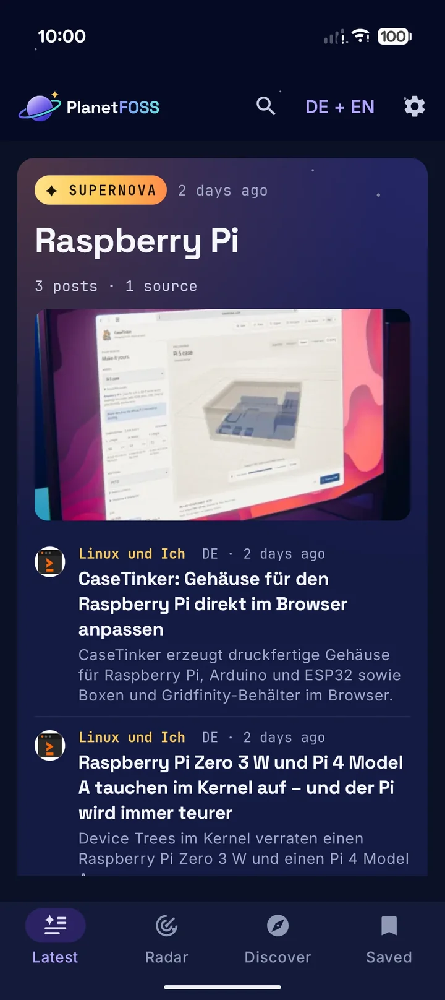
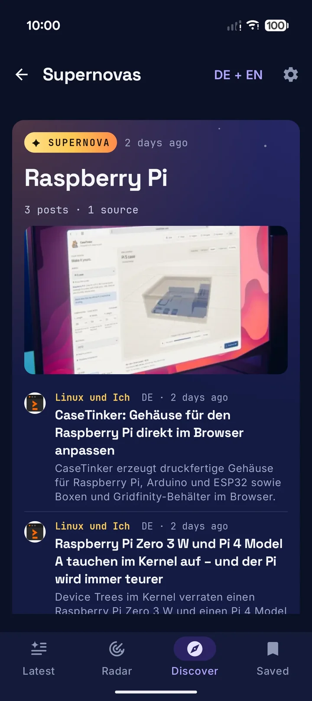
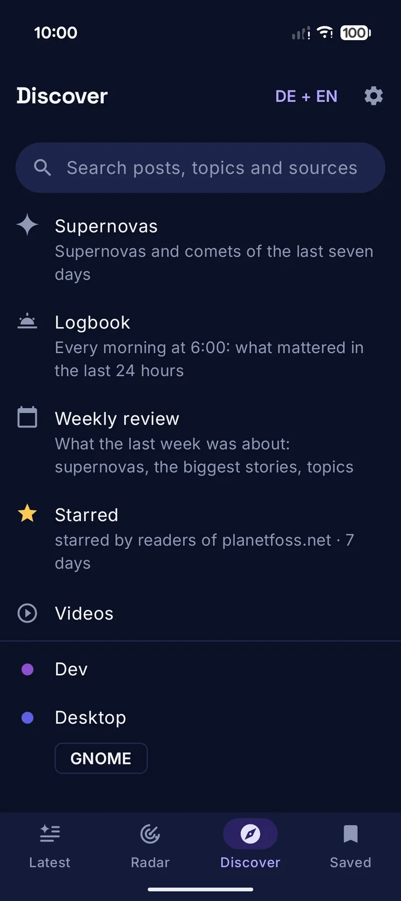
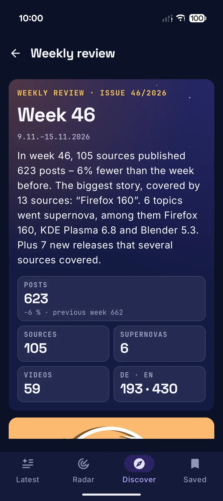

  

<h1 align="center">PlanetFOSS for Android</h1>

<strong>Linux and open source news from around 200 sources, on your phone.</strong>

  The app for <a href="https://planetfoss.net/en/">PlanetFOSS</a>, the news aggregator for Linux and free software.
  The big stories on top, a logbook every morning, a radar for what you follow.
  No account, no Google services, no tracking.

  <a href="https://github.com/linuxundich/planetfoss-android/releases/latest"><strong>Download APK</strong></a>
  &nbsp;·&nbsp;
  <a href="#install">Google Play: closed test</a>
  &nbsp;·&nbsp; F-Droid: planned &nbsp;·&nbsp;
  <a href="CHANGELOG.md">Changelog</a>

  
  
  
  

## What it does

### The big stories on top

PlanetFOSS collects posts from around 200 German and English blogs, magazines
and projects. When many of them cover the same topic at once, it becomes a
supernova. The *Latest* tab shows every burning supernova first, then the
comets, which are topics on the rise, and then the stream of the newest posts.
Every card leads to the original article.

### One story, one card

The same release news from five sites shows up once, bundled, with all the
reports listed. You see right away who writes what, and you don't scroll past
the same headline again and again.

### Follow instead of scrolling

Tap the bell on a topic or a source, and the *Radar* tab shows what is new
there since your last visit. What you follow and when you last looked in stays
on your phone.

### A logbook every morning, a review every week

Every day from 6 a.m. the logbook sums up the last 24 hours: the biggest story,
the comets and the new releases. On quiet days there is no entry. The weekly
review does the same for the last full week, with numbers, supernovas and the
most noticed releases. Both live under *Discover*, next to search, rubrics,
videos and the posts readers have starred.

 

### Notifications without a push server

If you like, the app tells you about new supernovas, the morning logbook and
what you follow. Android checks PlanetFOSS in the background for that, so there
is no push server and no Google service involved. Notifications are off until
you turn them on.

### Read now or later

Articles open in your phone's browser, or in the app's own browser with
optional protection from third-party trackers. The bookmark keeps posts under
*Saved*, also offline, and the collection can be exported to a file and
imported again. Two home screen widgets show the newest logbook and the topics
you follow.

### Private by design

No account, no analytics, no ads service. The app only talks to planetfoss.net
and to the sites you open. Counting opened articles for the sources is off
unless you switch it on. Everything that leaves the phone is listed in the
[privacy notes](PRIVACY.md).

## Install

PlanetFOSS needs Android 14 or newer. The interface comes in English and
German, the content in English, German or both.

**APK from GitHub**

1. Download `planetfoss-<version>.apk` from the [latest release](https://github.com/linuxundich/planetfoss-android/releases/latest).
2. Open it on your phone. Android asks once whether your browser may install apps.
3. Later versions install over the old one and keep your settings.

**Google Play, closed test**

The app is in closed testing on Google Play. New developer accounts need twelve
testers who stay for 14 days before an app may go public, so every tester
helps.

1. With the Google account on your phone, join the group [PlanetFOSS Tester](https://groups.google.com/g/planetfoss-tester).
2. On the [testing page](https://play.google.com/apps/testing/net.planetfoss.app), tap *Become a tester*.
3. Install the app from the link on that page and keep it for two weeks.

> [!NOTE]
> Google Play signs its builds with its own key. The APK from GitHub and the
> Play version cannot update each other, so switching means uninstalling
> first. Export your saved posts before you do.

## Questions

**Where does the news come from?**
From [PlanetFOSS](https://planetfoss.net/en/). The app fetches its public
lists and sends you to the original article for reading.

**Why do notifications sometimes arrive late?**
Android decides when the app may check in the background, between 15 minutes
and three hours depending on battery and usage. This is no live ticker.

**Does the app block ads?**
No. The app's browser can block third-party trackers if you switch that on.
The sites' ads stay, and the app passes PlanetFOSS on as the referrer, so the
sites see where their readers come from.

**Does it work without Google services?**
Yes. The app uses none of them, and it is built to be published on F-Droid.

**Can I use the PlanetFOSS name for my fork?**
The code is free software, the PlanetFOSS name and logo are not covered by its
licence. Please rename a fork.

## More

- [Technical notes](docs/TECHNICAL.md): building, testing and the design documents
- [Privacy notes](PRIVACY.md): everything that leaves the phone
- [Changelog](CHANGELOG.md) and [licences of all libraries and assets](LICENSES.md)
- Found a bug or missing something? [Open an issue](https://github.com/linuxundich/planetfoss-android/issues)

PlanetFOSS for Android is AI-assisted: the code was written with AI assistance,
following my directions. I made the decisions, reviewed the results and tested
everything on my own devices.

## License

Copyright (C) 2026 Christoph Langner

This program is free software: you can redistribute it and/or modify it under the
terms of the GNU General Public License as published by the Free Software
Foundation, either version 3 of the License, or (at your option) any later version.
See [LICENSE](LICENSE).

The PlanetFOSS name and logo are not covered by this licence.
