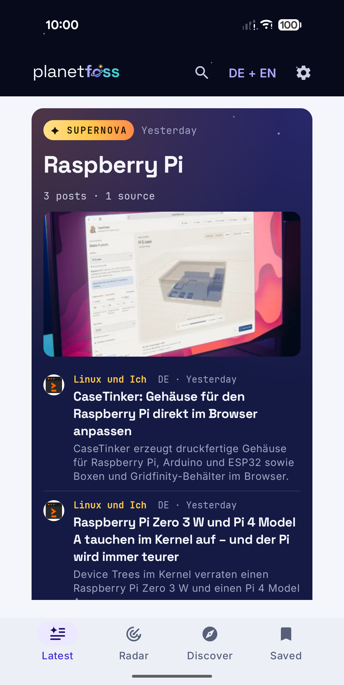
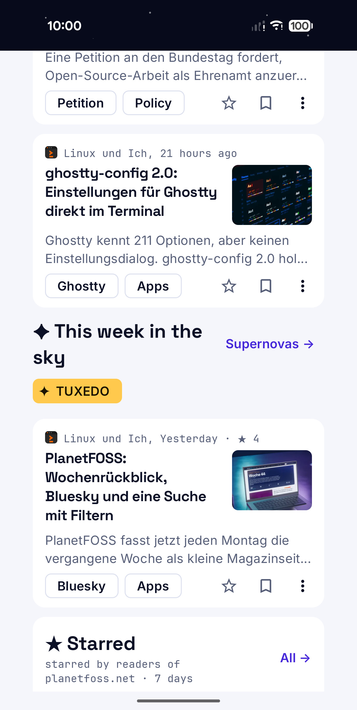
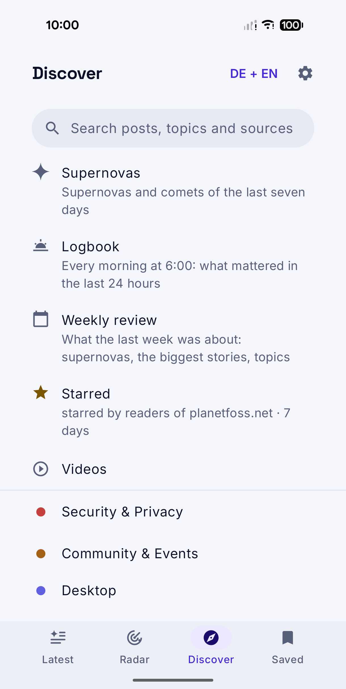
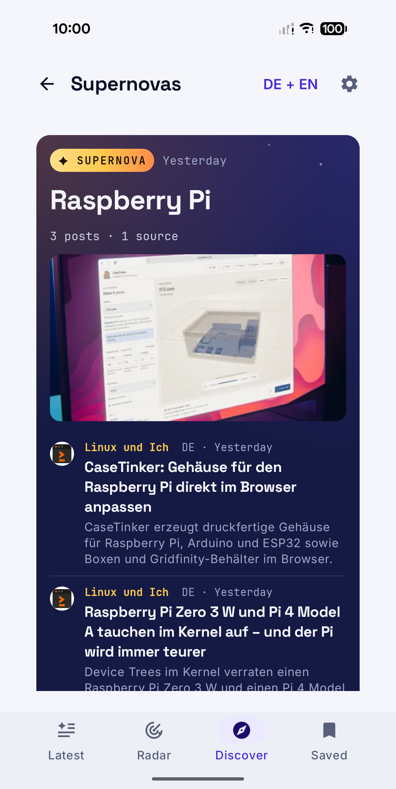

# PlanetFOSS for Android

A native Android app for [PlanetFOSS](https://planetfoss.net/en/), the Linux and open source
news aggregator that collects around 200 German and English sources. Every card leads to the
original article.

<p>
  
  
  
  
</p>

- **Latest** – supernovas (topics many sources report on at once) and rising comets on top, then
  the stream of the newest posts; the same story from several sources is bundled.
- **Radar** – what is new in the topics and sources you follow, marked since your last visit.
- **Discover** – search, the daily logbook (every morning at 6:00), the weekly review, starred
  posts, videos, rubrics, topics and sources.
- **Saved** – bookmarks, readable offline, with export and import.
- Notifications for supernovas, the logbook and what you follow (all off until you turn them on),
  and two home screen widgets.
- Articles open in your own browser or in the app's browser with optional protection from
  third-party trackers.
- Interface in English and German; content in English, German or both.

No account, no tracking, no ad or analytics services, no Google services. Counting opened
articles for the sources is opt-in ([PRIVACY.md](PRIVACY.md)). Runs on Android 14 and newer – the
versions that still get security updates. Free software under GPL-3.0-or-later, developed
AI-assisted.

## Install

**Status:** public test. The current version is on the
[releases page](https://github.com/linuxundich/planetfoss-android/releases/latest); what changed is in
the [changelog](CHANGELOG.md).

- **APK from GitHub:** download `planetfoss-<version>.apk` from the
  [latest release](https://github.com/linuxundich/planetfoss-android/releases/latest) and open it on
  your phone. Later versions install over it. The APK is signed with the developer's key
  (certificate SHA-256 `164875b3462be321c125b3c07127827346afbfdf5ec54afa234697471c70caa6`).
- **Google Play (closed test):** join the group
  [PlanetFOSS Tester](https://groups.google.com/g/planetfoss-tester) with the Google account on your
  phone, then become a tester on the
  [testing page](https://play.google.com/apps/testing/net.planetfoss.app). New developer accounts
  need twelve testers for 14 days before an app may go public, so every tester helps.
- **F-Droid:** planned.

Google Play signs its builds with its own key, so the APK from GitHub and the Play version cannot
update each other; switching means uninstalling first (export your saved articles before).

Found a bug or missing something? Please open an
[issue](https://github.com/linuxundich/planetfoss-android/issues).

## Notifications

Supernova notifications are off until you turn them on. The app then checks PlanetFOSS
periodically in the background (every 15 minutes to 3 hours, Android decides the exact
time). There is no push server and no Google service involved, so a notification can come
later than the supernova itself.

## Documentation

| Document | Content |
|---|---|
| [docs/01-analysis.md](docs/01-analysis.md) | PlanetFOSS as data source, supernova definition, push options |
| [docs/02-api.md](docs/02-api.md) | specification of the read-only app API on planetfoss.net |
| [docs/02-architecture.md](docs/02-architecture.md) | modules, stack, navigation, sync, browser, tracker protection, privacy |
| [docs/03-skeleton.md](docs/03-skeleton.md) | phase 3: what exists, device checks, deviations |
| [docs/04-core-features.md](docs/04-core-features.md) | phase 4: lists, search, saved, notifications, tests |
| [docs/05-browser.md](docs/05-browser.md) | phase 5: browser modes, security decisions of the internal browser |
| [docs/06-adblock.md](docs/06-adblock.md) | phase 6: tracker protection, filter list, limits; fair to the sources |
| [docs/07-qa.md](docs/07-qa.md) | phase 7: tests, network check, security review, licences, F-Droid, measurements |
| [docs/07b-ui-audit.md](docs/07b-ui-audit.md) | UI/UX audit: fonts and colours of the website, spacing scale, compact cards, settings dialogs |
| [docs/08-release.md](docs/08-release.md) | phase 8: store texts, privacy, F-Droid recipe draft, open decisions |
| [docs/09-latest-tab.md](docs/09-latest-tab.md) | the four tabs: Latest, Radar, Discover, Saved |
| [LICENSES.md](LICENSES.md) | licences of all libraries, assets and runtime data |

## Building

Requirements: JDK 17 or newer, Android SDK with platform 37 and build-tools 37.0.0
(`local.properties` with `sdk.dir=…`). No Google services, no API keys, no secrets.

```sh
./gradlew :core:test :app:testDebugUnitTest :app:lintDebug   # tests and lint
./gradlew :app:assembleRelease                                # unsigned release APK
```

`./gradlew :app:assembleQa -PPLANETFOSS_DEBUG_URL=…` builds the release configuration (R8)
signed with the debug key, for device tests before a release. `tools/licenses.py` checks
the licences of everything in the release APK; `tools/host-log-proxy.py` logs which hosts a
test device talks to. `app/src/main/baseline-prof.txt` (faster start) is recorded with the
`:baselineprofile` module, see [docs/08-release.md](docs/08-release.md#baseline-profile-2026-10-31).

Release signing is optional and read from `~/.gradle/gradle.properties`
(`PLANETFOSS_STORE_FILE`, `PLANETFOSS_STORE_PASSWORD`, `PLANETFOSS_KEY_ALIAS`,
`PLANETFOSS_KEY_PASSWORD`); without them the APK stays unsigned.

### Testing with fixed or crafted data

`tools/fixture-server.py` converts the public RSS feeds of planetfoss.net into answers
of the app API and serves them locally (development only, nothing is stored):

```sh
tools/fixture-server.py --port 8099   # --ads serves invented sponsor cards; --support SLUG=URL[|PROJECT] adds a support link or recommendation
adb reverse tcp:8099 tcp:8099          # phone over USB and emulator alike
./gradlew :app:installDebug -PPLANETFOSS_DEBUG_URL=http://localhost:8099/
```

## License

Copyright (C) 2026 Christoph Langner

This program is free software: you can redistribute it and/or modify it under the
terms of the GNU General Public License as published by the Free Software
Foundation, either version 3 of the License, or (at your option) any later version.
See [LICENSE](LICENSE).

The PlanetFOSS name and logo are not covered by this licence.
